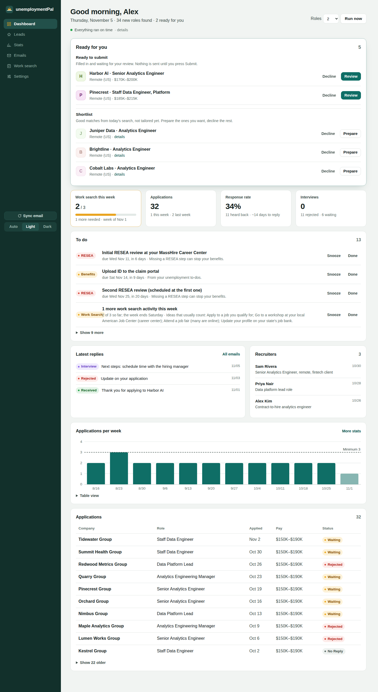
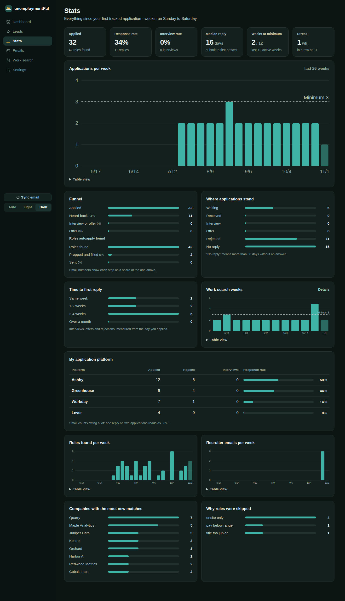
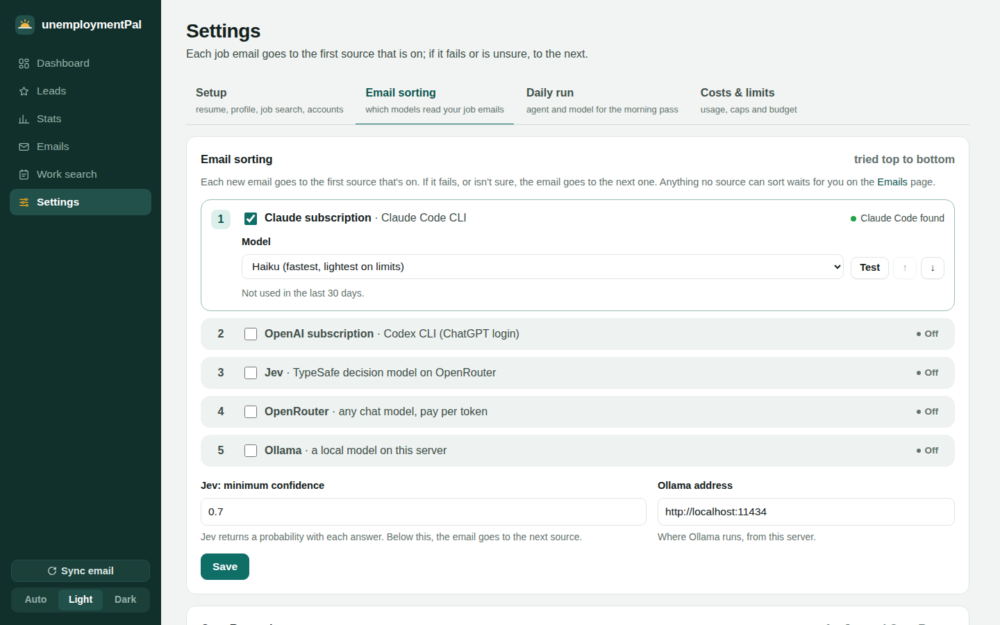
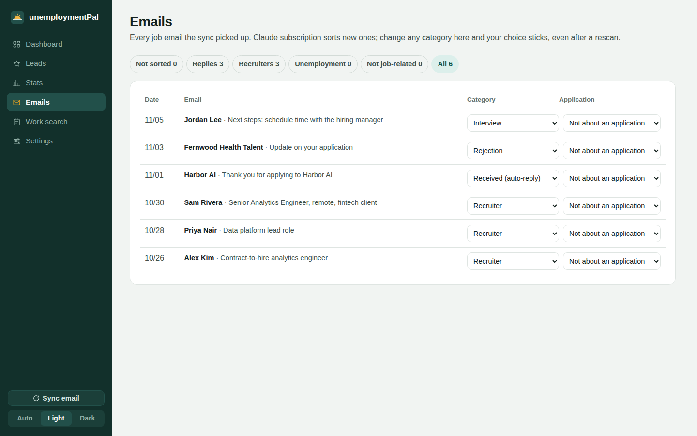
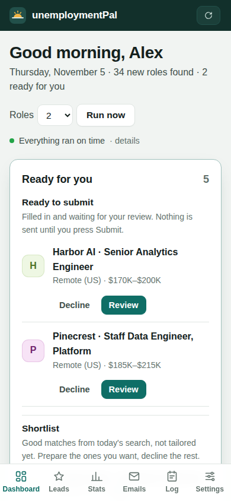
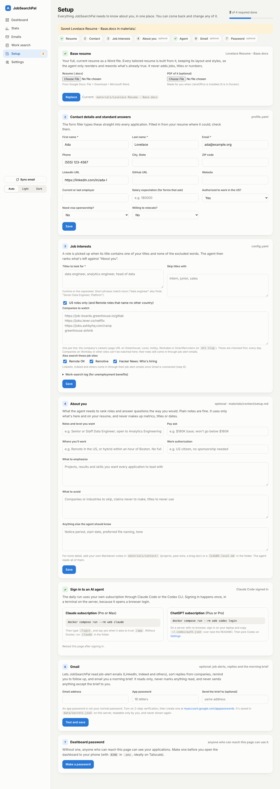

# JobSearchPal

A self-hosted job application assistant. Every weekday morning, an AI agent on your own subscription,
[Claude Code](https://claude.com/claude-code) or OpenAI's [Codex CLI](https://github.com/openai/codex), runs headless
on a small always-on server. It finds new roles, picks the best fits, tailors your
resume and cover letter, and fills the real application forms with Playwright, PDF uploads
included. **It never presses Submit.** You review each application on a private dashboard and send
it yourself.



<details><summary>Stats, Settings and Emails pages, and the phone layout</summary>





</details>

The screenshots use fictional demo data (`scripts/demo-data.py`).

## How it works

```
6:30am weekdays (cron or the Docker scheduler) ─► scripts/daily.sh, in short steps:
  no AI:     autoapply sync-email (a small model sorts the emails) · autoapply find (boards, job sites)
  light model, one fresh session each (prompts/stages/):
    ├─ prep      interviews ─► prep pack: reported questions with sources, your stories
    ├─ drafts    follow-up reminders ─► drafted replies
    └─ rank      autoapply candidates (pre-ranked in Python) + alert emails ─► today's picks
  main model, one fresh session per pick:
    └─ apply     tailor resume + cover letter ─► autoapply scan ─► plan.json ─► autoapply fill (stops before Submit)
  ─► autoapply brief --send      morning email: what's ready, new replies, where everything stands
you ─► dashboard ─► check answers, decide consents ─► Submit
   or: autoapply-finish <job> on your laptop ─► a real Chrome window, filled in, you submit
```

### A morning, step by step

1. **Email first.** New mail from application systems and recruiters is gathered over read-only
   IMAP. Keyword rules only pick the candidates. A model then reads each one and files it as a
   confirmation, interview, rejection, offer, recruiter contact or not job-related, and matches it to
   the application it's about (see [Email sorting](#email-sorting)).
2. **Interview prep and follow-ups.** Any application with a new interview email gets a prep pack, and
   each [follow-up reminder](#follow-up-reminders) gets a drafted reply (see [Interview prep](#interview-prep)).
3. **Find roles** from the sources below. Anything already tracked or applied to is skipped.
4. **Rank and pick** the best one or two, and skip the clear misses with a reason (the Stats page
   shows why roles were skipped).
5. **Tailor** a resume and cover letter from your base resume and `CLAUDE.local.md`, plus a
   `notes.md` with the fit/gap table, form answers and pay ask.
6. **Fill the real form.** Playwright answers the questions, uploads both PDFs, takes a screenshot
   and stops before Submit. Consent and self-ID questions get only your own standing answers, highlighted for you to check.
7. **Brief.** One email (sent to yourself over Gmail SMTP) with what's ready, interview prep
   packs, new replies, your work-search count for the week, and the status of every application.
8. **You decide.** Open the dashboard, read the answers, tick the review box and press Submit, or
   finish on your laptop when a site wants a code. Then the confirmation email arrives and the next
   morning's sync files it.

### Where jobs come from

- **Company job boards you watch** (Greenhouse, Lever, Ashby, Workable, SmartRecruiters) through
  their public APIs: the freshest source, and apply-ready. The run adds good companies as it finds
  them (`autoapply board add`), and on Mondays it looks for about 10 new ones.
- **Job sites with open APIs:** RemoteOK, Remotive, Hacker News "Who is hiring?", The Muse, Himalayas
  and Jobicy. No key needed.
- **Job sites with a free key:** Adzuna (a large US aggregator) and USAJOBS (federal jobs). Add the keys on
  the Setup page or in `.env`.
- **Any RSS or Atom job feed** (`rss_feeds` in `config.yaml`, or the Setup page): We Work Remotely, jobs.ac.uk and
  many others have them. Sites that answer automated requests with a bot check (HigherEdJobs does) are
  left to their job-alert emails; JobSearchPal doesn't try to get around those checks.
- **Your job-alert emails** from LinkedIn, Built In, Indeed, Glassdoor, Wellfound, HigherEdJobs (Job Agent emails), ZipRecruiter and Dice. For each good
  role, the agent finds the same posting on the company's own careers page and applies there, since
  aggregator listings are often stale.

Each run saves what every source returned to `data/sources.json`; the Setup page shows the counts, and a
source that failed, next to its name.

**LinkedIn** is covered only through its alert emails. LinkedIn has no public jobs API, and
scraping it or signing in as you breaks its terms and risks your account. To widen what the run
sees, set up several daily alerts with tight filters in LinkedIn (Jobs → set alert), for example
"analytics engineer · Remote · United States · past 24 hours" or "staff data engineer · Boston ·
Hybrid". Send them to the inbox the sync reads. Each alert you add shows up in the next morning's run.

### Email sorting

- **Sources, in your order.** On the Settings page, turn on any of: your **Claude subscription**
  (Claude Code, run with no tools), your **ChatGPT subscription** (Codex CLI, read-only sandbox),
  **Jev** (TypeSafe's decision model on OpenRouter, which returns a label with a probability),
  any **OpenRouter** chat model, or a local **Ollama** model. Each email goes to the first source.
  If that source fails, or Jev is below your confidence threshold, the email goes to the next.
- **Only labels come back.** Email text is treated as data. Answers that aren't a known category or
  a known application are dropped.
- **Nothing counts until it's sorted.** Stats, outcomes, the brief and the work-search log use sorted
  emails only. Anything no source could sort waits on the **Emails** page.
- **You have the last word.** The Emails page lists every job email by tab (Not sorted, Replies,
  Recruiters, Not job-related, All), with the text, the keyword guess and who sorted it. Change the
  category or the application from a dropdown. Your choice survives rescans and later model runs.

### Interview prep

When an email is sorted as an interview, the next morning's run writes a prep pack for that company
and stage (recruiter screen, hiring manager, technical, onsite). It's shown on the dashboard's
**Interviews** card and in the morning brief, and you can print it.

- **What candidates report:** the interview process and questions others have shared for that company
  and role, from public pages only (Glassdoor and Indeed pages readable without signing in, Reddit,
  Blind, levels.fyi, the company's own blog and handbook). Every item links its source, and the pack
  says so when little is public instead of making questions up.
- **Likely questions** drawn from the posting, labeled as such.
- **Your stories:** STAR answers built only from your materials, with your real numbers.
- **About them**, **questions to ask**, and **pay** (your ask and the posted range).

When a later interview email arrives (the next stage), the pack is updated for it.
`autoapply list --prep` shows what's due.

### Follow-up reminders

The dashboard's **To do** card and the morning brief remind you when:

- a recruiter wrote and you haven't replied (after a day),
- you wrote last and a recruiter has gone quiet (after 5 days): check in,
- an interview invite is waiting for your answer, or a booking link for your time,
- an application has had no answer beyond the confirmation for two weeks: a short follow-up note, or let it go.

"Replied" is read from your Sent mail (headers only, read-only). The daily run drafts a short reply for
each one, from your materials only. **Reply in Gmail** opens a compose window with the draft filled in, and you
send it yourself. Each reminder has **Done** and **Snooze 3 days**. `autoapply list --nudges` shows what
needs a draft.

### Costs and limits

Everything runs on what you already pay for, plus optional pay-per-token sources, and the Settings
page shows both:

- **Daily caps:** roles to tailor per day (the heaviest step), interview prep packs per day and follow-up
  drafts per day, each of which can be switched off. The daily run reads them first (`autoapply list --limits`).
- **Monthly budget for paid APIs:** once Jev and OpenRouter have billed that much this month (sorting and,
  if it runs on OpenRouter, the daily run), sorting uses only your subscriptions and local models and a
  daily run on OpenRouter is skipped until the 1st.
- **Usage, last 30 days:** daily runs and tokens, what that would cost at API prices (a gauge of how heavy
  each step is, since your subscription covers it), and what OpenRouter actually billed, by day.

**Why the run is split into steps.** An agent session re-reads its whole conversation on every turn, so one
long morning session gets heavier with each step (one run used about 6.8M tokens, mostly these re-reads).
Each step now starts fresh, roles are pre-ranked in Python so the agent reads only the top 12 with trimmed
descriptions, and the light steps use a lighter model. Costs & limits shows tokens per step.

**Quick pick.** With an OpenRouter key, set *Quick pick* on Settings > Daily run to any cheap model
(e.g. `google/gemini-2.5-flash`). The day's roles are then picked in one chat call, usually well under a cent,
instead of an agent session. The same model reads yesterday's job-alert emails (LinkedIn, Indeed, HigherEdJobs)
and lists the roles that fit; a short light-model agent step then looks up only those on the company's own site.
It picks only among tracked roles, and falls back to the agent if a reply is bad or on the weekly discovery day. Tailoring and form
filling stay with the agent and its main model, since they need many tool turns and good writing.

To spend less: choose Sonnet or Haiku for the daily run, tailor one role a day, and keep email sorting on
Haiku or a local model.

### Settings page

Four tabs. The menu's Settings item opens **Setup** first, with a badge while a required step is missing.

| Tab | What you set |
|---|---|
| Setup | resume, contact details, job interests and job sites, notes about you, agent sign-in, Gmail, dashboard password (see Docker below). |
| Email sorting | which sources are on, their order (↑ ↓), the model for each (OpenRouter's list comes with live prices), Jev's minimum confidence, the Ollama address. Each source has a **Test** button that sorts a sample email and shows the answer, time and cost, plus 30-day counts of emails sorted, cost and failures. |
| Email sorting: OpenRouter key | for Jev and OpenRouter. It's stored in `data/secrets.json` (owner-only) and never shown again. A key in `.env` wins. |
| Costs and limits | daily caps for tailoring, prep packs and drafts; the monthly budget for paid APIs; 30-day usage and cost by day. |
| Daily run | the agent (Claude Code or Codex CLI, with what's installed and signed in), what pays for its model (your subscription, or an OpenRouter key billed per token), and the model. Opus writes the best cover letters; Sonnet or Haiku go easier on usage limits. |

Choices are saved in `data/settings.json`. Nothing on the page needs a restart.

### Dashboard pages

- **Dashboard:** a to-do list of follow-ups, what's ready for you, interviews with their prep packs, latest replies, recruiters, applications per week, the full
  application list, and when each job (search, email sync, sorting, brief) last ran.
- **Stats:** response and interview rates, median time to reply, funnels, results by application
  platform, reply-time buckets, weeks at your work-search minimum, and pipeline trends.
- **Emails:** see above.
- **Settings:** Setup, Email sorting, Daily run, and Costs & limits tabs (above).
- **Work-search log:** if you claim unemployment benefits, every application and recruiter contact
  is grouped by Sunday-to-Saturday week, with the original emails and submit screenshots saved as
  proof and a weekly zip in work-search-log columns.

Light and dark mode, and it works on a phone.

## What it will not do

- **Submit for you.** The CLI has no submit command. The only Submit button is on the dashboard,
  behind a review tick box, and each approval covers one click.
- **Answer consents or self-ID questions.** Privacy acknowledgements, AI-policy consents and
  demographic questions are never answered by the agent (`hold_for_review` in `profile.yaml`). You can
  save your own standing answers on Settings > Setup; the filler pre-fills those, and the review page shows
  them in a highlighted **Check these** box so you confirm them on every application.
- **Get past bot checks.** No captcha solving, no reading verification codes, no logins, no
  account creation. When a site asks for a code, use `autoapply-finish` and enter it yourself.
- **Workday and other account-based sites.** Materials are prepared and the role is flagged
  "apply by hand".

`AGENTS.md` gives the agent these rules (Codex reads it directly; `CLAUDE.md` imports it). With Claude
Code, `.claude/settings.json` also blocks edits to the tool's own code; Codex runs with writes limited to
this folder, so for it that rule is an instruction only. Either way these are guardrails, not a sandbox:
the review step is the real safety net.

## Permissions: what you hand over

Know what each piece can reach before you turn it on.

**The daily agent (Claude Code).** It runs unattended with `--permission-mode acceptEdits`, so it can
create and edit files in this folder without asking. Commands it may run come from the `allow` list in
`.claude/settings.json`: the `autoapply` steps it needs, `soffice` for PDFs, `python3` (used to build the
tailored .docx), `mkdir`, `ls` and `cat`, plus web search and fetch for company research. Anything
else stops the step, and the dashboard shows that step as failed. The `deny` list blocks
`autoapply serve`, `sqlite3`, and edits to `autoapply/` and `.claude/`. Be aware that `python3:*` is broad: Python
can do whatever your user account can. If that's too much for you, run it in Docker or as a separate
low-privilege user.

**The daily agent (Codex).** Runs with `--sandbox workspace-write`, network on and no approval prompts:
writes are limited to this folder, but there is no command allow list.

**Gmail (app password, optional).** An app password grants full IMAP and SMTP access to the mailbox,
the same as your password, minus the 2-step check. JobSearchPal uses it to read job emails in All Mail, Spam and Trash (each opened read-only,
messages fetched with `BODY.PEEK` so they stay unread) and to send you the morning brief. It never
sends anything else, never deletes and never marks as read. It is stored in `.env` or `data/secrets.json`
(owner-only). It also reads the headers (not bodies) of mail you sent, to tell when you've replied. A separate
job-search Gmail limits what the password can reach. To cut it off, revoke it at myaccount.google.com/apppasswords.

**OpenRouter key (optional).** Pay per token. Email sorting and Quick pick stop for the month at
the budget on Settings > Costs & limits; set a credit limit on the key itself too.

**The dashboard.** It shows your applications, emails and answers. It listens on `127.0.0.1` unless you
set `BIND`. Set a dashboard password (Settings > Setup, step 7) before you open it to your phone or network,
and prefer a private network such as Tailscale.

**What leaves your server.** Job emails, your resume and notes go to the model you pick (your Claude or
ChatGPT subscription, or OpenRouter/Jev if you turn them on); Ollama stays local. Postings are fetched from
public job boards. The form filler types your real name, email and files into the company's own form, and
nothing is sent until you press Submit.

**What stays on disk, unencrypted.** Resumes, tailored documents, answers, copies of job emails and form
screenshots live in `materials/` and `data/`. Keep the folder private and back it up.

**Adding a step?** If a prompt uses a new `autoapply` command, add it to the `allow` list. A test
(`tests/test_daily.py`) fails if a prompt uses a command the agent isn't allowed to run.

## Setup (about 30 minutes)

You need an always-on Linux box (Ubuntu 24.04 tested), **either** a Claude subscription (Pro or Max,
for Claude Code) **or** a ChatGPT subscription (Plus or Pro, for the Codex CLI), and ideally
[Tailscale](https://tailscale.com) so the dashboard is reachable only from your devices. Email sorting
can also use an OpenRouter key or a local Ollama model.

| You have | Daily run | Email sorting |
|---|---|---|
| Claude subscription | Claude Code | Claude (Haiku) |
| ChatGPT subscription | Codex CLI | Codex |
| Either, plus an OpenRouter key | as above | Jev or any OpenRouter model first, the subscription as backup |
| Either, plus a GPU or spare CPU | as above | a local Ollama model, nothing leaves the server |
| Only an OpenRouter key | Claude Code (Anthropic models) or Codex CLI (most models) on the key | Jev or any OpenRouter model |

The OpenRouter route for the daily run follows OpenRouter's own guides: Claude Code talks to its
Anthropic-compatible endpoint, and Codex uses it as a custom provider. Each run's real cost is read from
the key's usage before and after, and the run is skipped once the month's budget is reached.

1. Clone this repo to `~/auto-apply` on the server and run `bash scripts/install.sh`
   (`AGENT=codex bash scripts/install.sh` for Codex).
2. Start the dashboard (`autoapply serve`) and use its **Setup** page (see Docker below for the steps), or
   copy the examples and fill them in:
   - `config.example.yaml` → `config.yaml` (boards to watch, title keywords, dashboard host,
     work-search label and weekly minimum)
   - `profile.example.yaml` → `profile.yaml` (your contact details and standard answers)
   - `.env.example` → `.env` (a long random `AUTOAPPLY_TOKEN`, `REVIEW_URL`, Gmail app password)
3. Put your files in `materials/` (see `materials/README.md`), and write `CLAUDE.local.md` with
   personal facts the agent should use (the same file works for Codex): work authorization, titles and dates, pay asks, location
   preferences, how to name files. Both are gitignored.
4. Sign in once: `claude` in the folder (sign in and trust it), or `codex login`.
5. `pytest` to check the form filler, then `bash scripts/daily.sh` for a first run.
6. Start the dashboard as a service and schedule the daily run:
   ```
   cp scripts/autoapply-review.service ~/.config/systemd/user/
   systemctl --user enable --now autoapply-review
   sudo loginctl enable-linger $USER
   crontab -e   # add the line from the top of scripts/daily.sh
   ```
7. Open `REVIEW_URL?t=<your token>` once on each device. A cookie remembers it. On the **Settings**
   page, pick the daily-run agent and model and the email-sorting order.
8. Optional, on your laptop: `bash scripts/mac-setup.sh <ssh-host>` installs `autoapply-finish`.

Updating later: `git pull && .venv/bin/pip install -e . && systemctl --user restart autoapply-review`.

## Docker (alternative to steps 1, 4 and 6)

One image has Python, Playwright's Chromium, LibreOffice and both agent CLIs, so nothing else gets
installed on the host. Your files stay in the repo folder, which is mounted into the containers.

```
git clone https://github.com/harung1993/jobSearchPal.git ~/auto-apply && cd ~/auto-apply
docker compose up -d --build                # dashboard + the daily scheduler
docker compose run --rm web claude          # sign in to Claude Code and trust /app (or: codex login)
```

Then open `http://localhost:8787/` (or `http://<server>:8787/` with `BIND` set, below). A fresh install opens
the **Setup** page, which walks through everything in a browser:

1. **Base resume**: upload your .docx (a PDF is made for you). Tailored resumes are built from it.
2. **Contact details and standard answers** (prefilled from the resume), saved to `profile.yaml`.
3. **Job interests**: titles to look for and skip, US-only, companies to watch (paste careers-page URLs from
   Greenhouse, Lever, Ashby, Workable or SmartRecruiters) and job sites, saved to `config.yaml`.
4. **About you** (optional, recommended): roles and level, pay ask, where you'll work, work authorization,
   what to emphasize and avoid, saved to `materials/context/setup.md`.
5. **Agent sign-in**: the command above; the page shows when it worked.
6. **Gmail** (optional): an app password, tested before it's saved, for job alerts, replies and the brief.
7. **Dashboard password** (optional, recommended before you open it beyond localhost).



Until steps 2 and 3 are done, the daily run does nothing. The Setup page writes the same files you could edit
by hand, so either way works; keys it saves go to `data/secrets.json` (owner-only), and `.env` wins over them.

- **Dashboard:** port 8787 on `127.0.0.1` by default. Add `BIND=<your Tailscale IP>` to `.env` to
  reach it from your phone.
- **Schedule:** `DAILY_AT=06:30`, `DAILY_DAYS=1-5` and `TZ=America/New_York` in `.env` (these are
  the defaults). Output goes to `data/cron.log` as before.
- **Your user id:** the containers run as uid 1000 so files in the folder stay yours. If `id -u`
  says otherwise, add `APP_UID` and `APP_GID` to `.env`.
- **Logins** live in the `agent-home` volume, so a rebuild keeps them.
- **Updating:** `git pull && docker compose restart`. Code runs from the mounted folder; rebuild
  (`docker compose up -d --build`) only when dependencies change.
- Codex sign-in on a headless box: sign in on a laptop and copy `~/.codex/auth.json` in with
  `docker compose cp ~/.codex/auth.json web:/home/app/.codex/auth.json`.

## Commands

```
autoapply find                         new matching roles from boards and feeds
autoapply board add ATS SLUG           watch another company's board (checked first)
autoapply alerts [--days N]            job-alert emails as text
autoapply sync-email [--days N] [--rebuild]   replies and recruiter emails → sorted → dashboard and proof
autoapply review-emails                sort emails still waiting, through the Settings page's sources
autoapply emails [--pending]           filed emails as JSON;  emails set ID KIND  settles one by hand
autoapply import-history FILE.json     load past applications (tracker rows)
autoapply add URL / list / show ID / skip ID
autoapply list --prep                  interviews that need a prep pack
autoapply list --nudges / --limits     follow-ups that need a draft; today's caps
autoapply scan URL                     a form's questions as JSON
autoapply fill PLAN.json [--job ID]    fill, upload, screenshot, stop before Submit
autoapply brief [--send]               the morning summary
autoapply daily-agent                  the agent and model the daily run will use
autoapply serve                        the dashboard
autoapply finish JOB_ID                (laptop) open the filled form in Chrome for you to submit
```

## Layout

```
autoapply/cli.py         the commands the agent calls
autoapply/fillers/       scan.js reads any form; base.py fills and submits per ATS
autoapply/finder.py      job-board APIs and feeds
autoapply/emailsync.py   gathers candidate emails, proof copies, applies a settled kind
autoapply/classify.py    model review of waiting emails (Claude Code, Codex, Jev, OpenRouter, Ollama)
autoapply/prefs.py       Settings page choices (data/settings.json) and saved API keys
autoapply/prep.py        interview prep packs: what's due, where they live, safe rendering
autoapply/nudges.py      follow-up reminders from sorted emails and your Sent mail
autoapply/stats.py       dashboard and stats numbers
autoapply/web.py         dashboard, review page, work-search log
autoapply/templates/     HTML (no build step, no JavaScript framework)
prompts/stages/          the daily run's steps (rank, apply, prep, drafts), one agent session each
AGENTS.md                standing rules for the agent (CLAUDE.md imports it; personal facts go in CLAUDE.local.md)
tests/                   local fixture forms and tests
```

## Development

```
python3 -m venv .venv && .venv/bin/pip install -e ".[dev]" && .venv/bin/playwright install chromium
.venv/bin/pytest
python3 scripts/demo-data.py /tmp/demo && cd /tmp/demo && autoapply serve   # http://127.0.0.1:8799
```

The filler is tested against local copies of each ATS's form layout (`tests/fixtures/`). Real
forms change, so expect to tweak labels and selectors in `autoapply/fillers/`. Issues and pull
requests are welcome, especially new ATS fillers and better reply classification.

## License

MIT. See [LICENSE](LICENSE).
